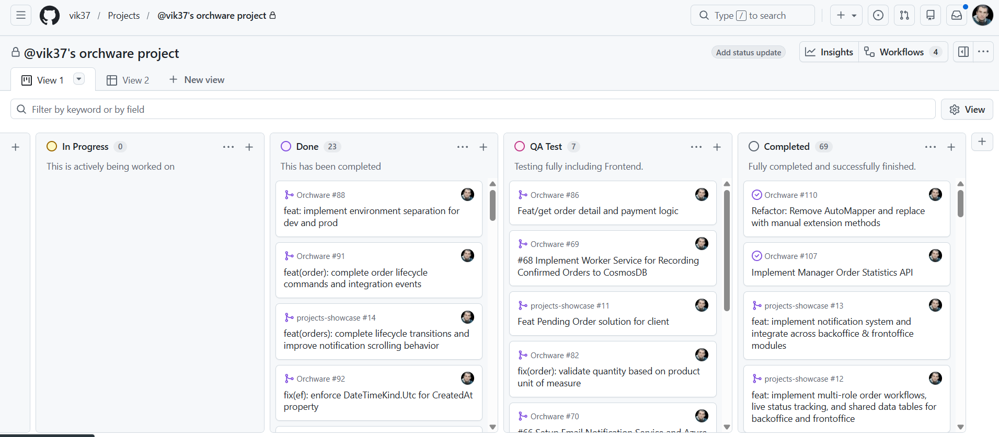
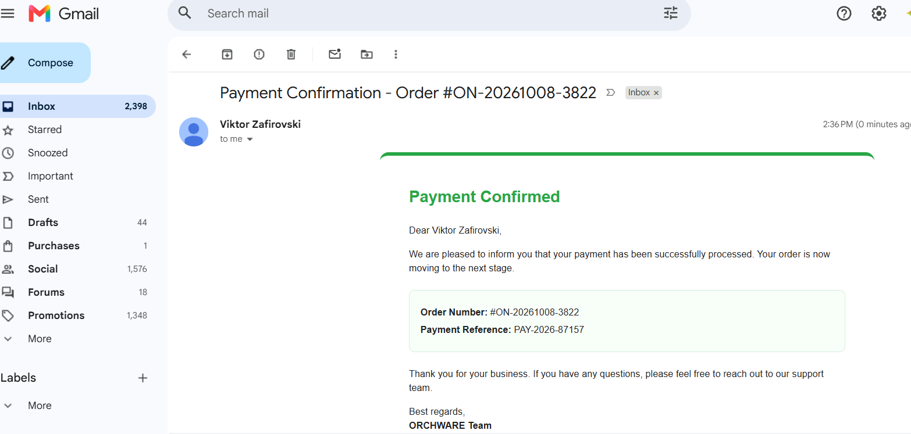
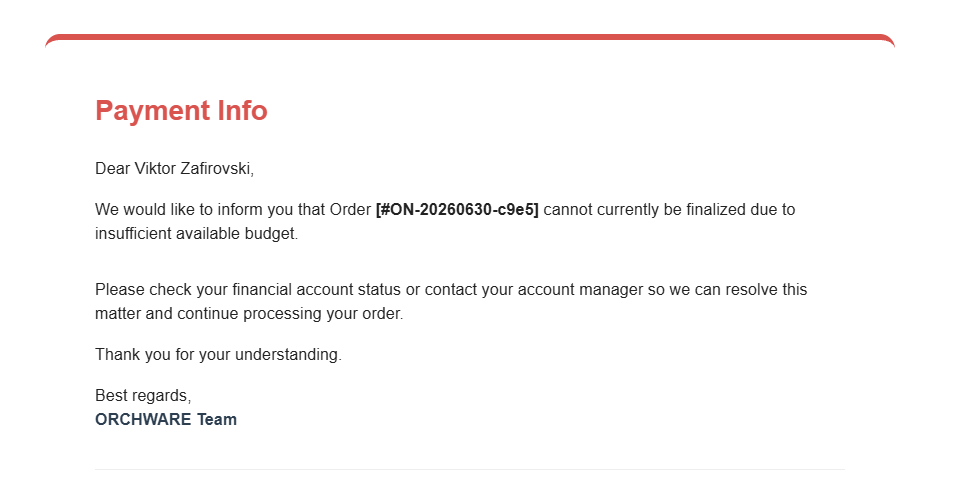
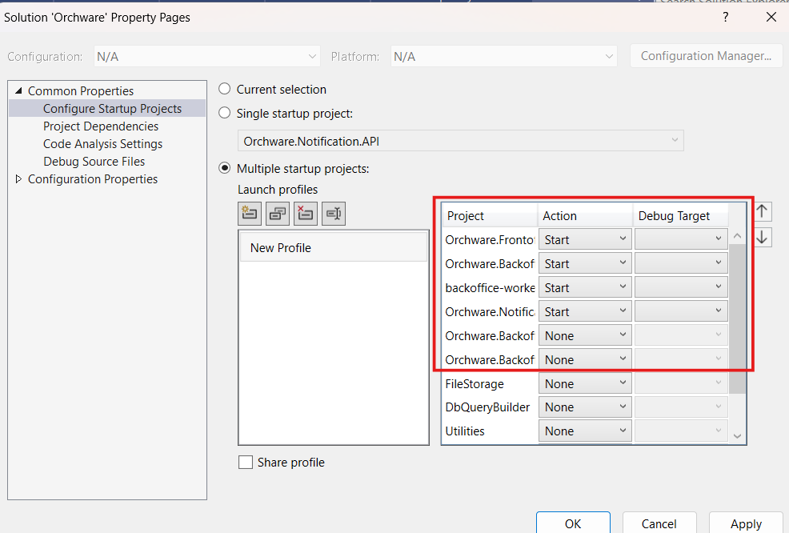
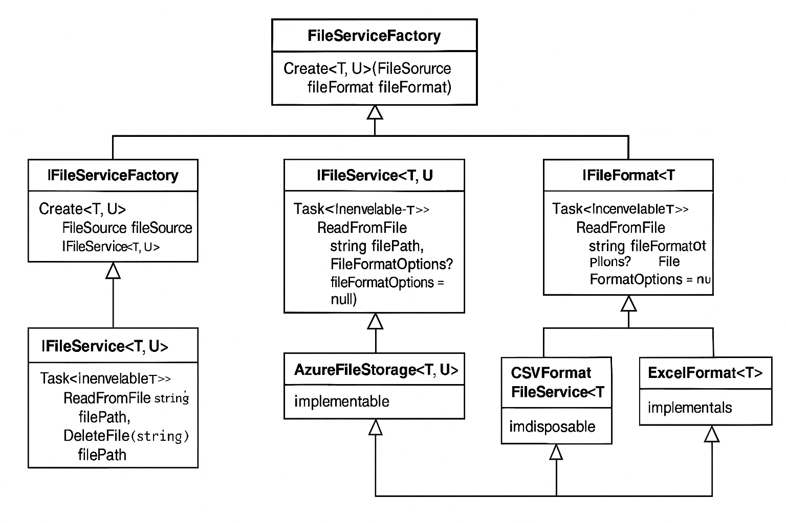
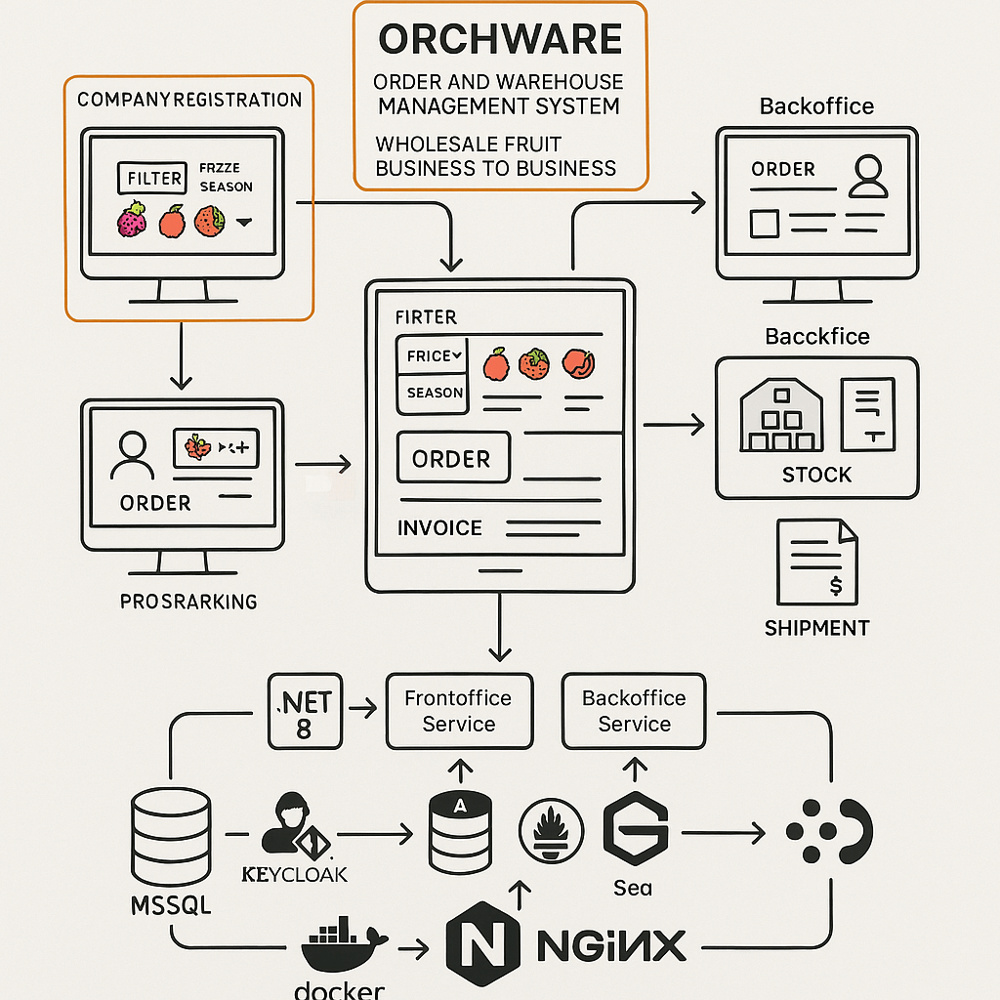
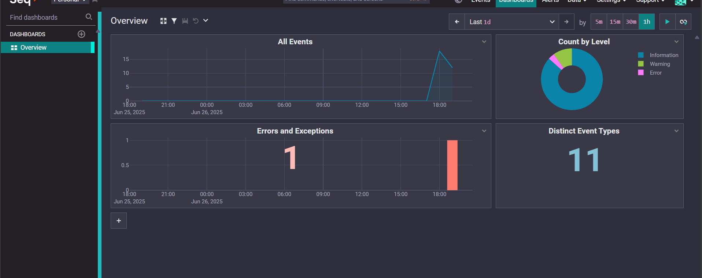
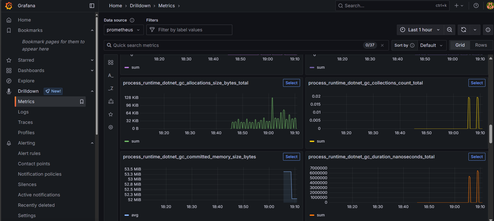
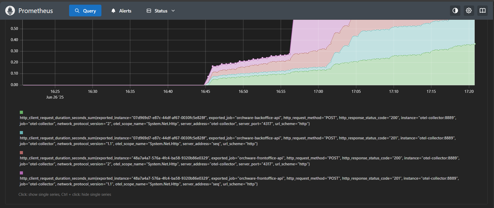

# Orchware-public

## Reference to the private Orchware repo—core foundation of this project.

_"Limited access to the core code may mean some functionalities are not directly visible here."_

## Live Demo

Orchware is a warehouse management system built using Angular (frontend) and ASP.NET (backend), containerized with Docker and deployed via GitHub Actions.  

🌐 **Live app:** [https://viktor-showcase.dev/orchware](https://viktor-showcase.dev/orchware)

:book: **PDF Documentation**
[Orchware_Description.pdf](https://viktorshowcasedev.blob.core.windows.net/orchdesc/Orchware_Description.pdf)       
A detailed description of the system's business logic, design, and development process.

----

## 🚀 Current Status – Completed

Orchware is a completed independent portfolio project featuring separate Frontoffice and Backoffice applications, supported by dedicated API services and background processing through a Billing Worker.

The application includes:

- 🛒 **Frontoffice** – Product browsing, company registration, order placement, order tracking, and payment management.
- 📦 **Backoffice** – Inventory management, order processing, warehouse operations, and administrative functionalities.
- 🔔 **Notification Service** – Email notifications and real-time updates using SignalR.
- 🧾 **Billing & Invoicing** – Automated invoice generation and payment processing workflows.
- 📊 **Observability** – Centralized logging, distributed tracing, and metrics monitoring.

The application is containerized with Docker and supported by a CI/CD pipeline for automated builds and deployment.

Although the core implementation is complete, the project may continue to receive improvements, refinements, and maintenance.

💬 _Feedback and suggestions are always welcome!_

  
# Agile Methodology - Kanban
## 📊 Issue Count by Status <!-- STATUS START -->



<!-- STATUS END -->
---

### 🧱 Tech Stack

       
     

---

### ⚙️ Deployment & CI/CD

  [](https://viktor-showcase.dev/orchware) 


---

### Authentication & Authorization (Keycloak Integration)

This project leverages robust **Authentication and Authorization** mechanisms to secure its services and manage user access. For this purpose, I've chosen to implement **Keycloak**, an open-source Identity and Access Management solution, primarily for its capabilities in providing **Single Sign-On (SSO)** across various applications.

To simplify setup and demonstrate the system's security features, you can easily import the pre-configured Keycloak Realm.

#### Quick Keycloak Setup:

1.  **Start Keycloak:** Ensure your Keycloak instance is running (e.g., via Docker Compose).
2.  **Import Realm Configuration:**
    * Navigate to your Keycloak Admin Console (e.g., `http://localhost:8080/admin`).
    * Click on **"Add Realm"** (or **"Create Realm"**).
    * Select the **"Import realm"** option and upload the `keycloak-config/orchware-dev-realm.json` file from this repository.

    **📺 For a step-by-step visual guide on importing the JSON, watch this video:**
    [Import JSON file to Keycloak example](http://www.youtube.com/watch?v=XpHxA46w9F4)
 
    - File location: `keycloak_json/realm-export.json`

    * **For quick testing, you can create the following demo users with pre-defined roles:**
        * **manager:**
            * Username: `manager@orchware.com`
            * Password: `manDemo123!`
            * Roles: Ensure this user is assigned the `manager` role (and potentially `user` if needed for general access).
        * **warehouseman:**   
            * Username: `warehouse@orchware.com`
            * Password: `Whouseman123!`
            * Roles: Ensure this user is assigned the `warehouseman` role (and potentially `user`).        
      * **administrator:**                  
      	* Username: `admin@orchware.com`     
        * Password: `Admin123!`    
        * Roles: Ensure this user is assigned the `admin` role (and potentially `user`).       
        * Purpose: Used to simulate customer installment payments through the Payment Settings functionality.       
      * **(Optional) Regular User:**         
        * **You can register a new user directly through the application's UI.** Any new user registered this way will automatically be assigned the `user` role.

* **Important Notes for Keycloak Setup:**
       - **Users and Client Secrets:** When exporting and then importing Keycloak Realm JSON, user accounts and client secrets _(confidential clients)_ are not included. They need to be added manually, as shown in the video. _(I'm not fully certain why this is the default behavior or if there's a specific export option to include them, and it's something I plan to investigate further.)_

### 📺 Video (Login) Demonstration

[](https://www.youtube.com/watch?v=ZpnFk_w-wmE)

> **Click on the image above** to watch the video on YouTube!
#### Authorization Policies in Backend (.NET)

The backend (`Orchware.Frontoffice.API`) implements custom authorization policies to manage access based on user roles from Keycloak. A key example is the `NonEmployeeUser` policy:

```csharp
builder.Services.AddAuthorization(opt => {
    opt.AddPolicy("NonEmployeeUser", policy =>
    {
        policy.RequireAssertion(ctx =>
        {
            var roles = ctx.User.FindAll(ClaimTypes.Role).Select(r => r.Value);
            var hasUserRole = roles.Contains("user");
            var isEmployee = roles.Any(r => new[] { "manager", "warehouseman" }.Contains(r));

            return hasUserRole && !isEmployee;
        });
    });
});
```     

### Keycloak Configuration Example for Production

For production, Keycloak typically runs behind a reverse proxy (like NGINX or Traefik) that handles HTTPS/SSL termination. The Keycloak `command` and environment variables need to reflect this.

Here’s an example of how the Keycloak service within your `docker-compose.yml` might look for a production setup:

```yaml
keycloak:
  image: quay.io/keycloak/keycloak:24.0 # Or your specific production image
  container_name: keycloak # Or a more descriptive name
  command: start # Important: Use 'start' for production, not 'start-dev'
  environment:
    KC_DB: postgres
    KC_DB_URL_HOST: your-production-db-host # Point to your external production DB
    KC_DB_URL_DATABASE: keycloak
    KC_DB_USERNAME: keycloak
    KC_DB_PASSWORD: your-secure-db-password! # Use a strong, secure password
    KEYCLOAK_ADMIN: admin
    KEYCLOAK_ADMIN_PASSWORD: your-secure-admin-password! # Use a strong, secure password
    KC_HTTP_ENABLED: false # Keycloak listens for HTTP but expects a proxy to handle HTTPS
    KC_HOSTNAME: auth.your-domain.com # Replace with your actual authentication subdomain
    KC_PROXY: edge # Tells Keycloak it's behind a reverse proxy
    # Add other production-specific environment variables as needed
  # ports: # Do NOT expose ports directly to host in production; let proxy handle it
  #   - "8080:8080" # Remove or comment out this line in production
  # volumes: # Adjust volumes for persistent data and backups
  #   - keycloak_data:/opt/keycloak/data
  # depends_on: # If using an external DB, this might change
  #   keycloak-db:
  #     condition: service_healthy
  restart: unless-stopped # Ensure Keycloak restarts if it crashes
  ```

### 🔐 Authentication is handled by Keycloak:  
[https://auth.viktor-showcase.dev](https://auth.viktor-showcase.dev)  
_(Admin access is not publicly exposed)_


---

### 📊 Repository Stats

**About This Repository**
This is a public reference of the Orchware project, primarily intended for showcasing the live application and giving insight into the architecture.

🔒 The core development activity (including **CI/CD** pipelines, detailed configuration, project management, and full issue tracking) is maintained in a private repository.

This public version is configured slightly differently — just enough to run the app locally or explore how it works.
The source code here is 99% identical to the private repo, with only minor adjustments made for deployment and security reasons. 


----------

📦 **Orchware System**  
**Orchware** is a system for managing **Backoffice and Frontoffice services**, built on **.NET 8** with a focus on **clean and modular architecture**.  
It handles **inventory, orders, and shipping operations**, using modern **DDD**, **Vertical Slice Architecture**, and a **Common Library** for shared functionalities.  

## 📑 **Table of Contents**  
🔹 [Business Overview](#-business-overview)    
🔹 [Business Logic & Order Flow](#-business-logic--order-flow)   
🔹 [Cancellation Flow](#-cancellation-flow)  
🔹 [Payment Rules & Dynmaic (Rules) Configurations](#-payment-rules--dynamic-configuration)  
🔹 [Payment Simmulations](#-bank-payment-simulation--azure-invoice-service)  
🔹 [Technical Overview](#-technical-overview)        
🔹 [Technologies Used](#technologies-used)    
🔹 [Project Structure](#-project-structure)  
🔹 [Setup Instructions](#setup-instructions)  
🔹 [Common Libraries](#-common-libraries)  
🔹 [UML Diagram](#uml-diagram)  
🔹 [Docker Support](#-docker-support)    
🔹 [Additional Context](#additional-context)  
🔹 [Articles & Publications](#articles--publications)  
🔹 [License](#license)  
| 🔹 [What's New](#news)                                                                                                     |
|-----------------------------------------------------------------------------------------------------------------------------|
|   :arrow_right_hook: [Backoffice Updates](#-backoffice-updates)                                                             |
|=============================================================================================================================|
|   :arrow_right_hook: [Observability: Monitoring & Tracing](#completed-feature---06302025)                                   |
|=============================================================================================================================|
|   :arrow_right_hook: [Introduce a comprehensive Company Registration and Management Module](#completed-feature---08282025)  |
|=============================================================================================================================|
-------------------------------------------------------------------------------------------------------------------------------
---

## 📌 **Business Overview**

**Orchware** is an independent portfolio project designed to simulate real-world fruit wholesale and warehouse operations through a modular architecture with clearly separated Frontoffice and Backoffice applications.

The system consists of the following main components:

🔹 **Frontoffice Service** – Provides customer access to product browsing, company registration, order placement, order tracking, and payment management.

🔹 **Backoffice Service** – Handles inventory management, order processing, payment-related operations, and warehouse logistics.

🔹 **API Service** – Provides dedicated API functionality supporting the application's business operations.

🔹 **Notification Service** – Handles event-driven customer and manager notifications through email and real-time communication using SignalR (WebSockets). Integrates with **Azure Event Grid** to listen for invoice PDF uploads to **Azure Blob Storage**, retrieve the generated invoices, and deliver them to customers as email attachments, with the manager included in CC. It also communicates with other application services through RabbitMQ integration events.

🔹 **Backoffice Billing Worker** – A scheduled background worker responsible for processing billing tasks, managing installment processing, and initiating invoice PDF generation through Azure Cosmos DB.

🔹 **Common Libraries** – Provide shared utilities and components for file handling, structured SQL queries, validation, and other cross-cutting functionality.

Together, these components support the complete wholesale workflow, from company registration and order creation to inventory processing, invoicing, payment management, and final shipment.


---

## 🚀 Business Logic & Order Flow

### $${\color{green} Roles \space in \space Orchware}$$        
> Manager: Oversees customer orders, inventory shortages, payment tracking, and approvals.  
> Warehouseman: Packs, loads, and ensures shipments are prepared for transport.      
> Order Lifecycle & Statuses    

1️⃣ **Customer selects products** → Pending Order  
2️⃣ **Order request sent** → Status: Requested  
3️⃣ **Manager confirms availability** → Status: Confirmed  
4️⃣ **Warehouse processes shipment** → Status: Assigned to Warehouse / In Preparation  
   * *The warehouseman starts packing and preparing the items.*  
   * *Once packing is complete, the warehouseman moves it to the Kanban/Status: **Awaiting Dispatch**.*

5️⃣ **Payment & Quality Inspection (Awaiting Dispatch stage):**  
   * *The warehouseman checks if the order has been paid.*  
   * *If paid, it goes through an internal inspection to verify that the items are properly packed and error-free.*  
   * *Once verified, it is marked as **Approved** for the final delivery stage.*  
   *(Note: Advanced payment/inspection approval workflows are designed as future/optional extensions).*  

6️⃣ **Shipment begins** → Delivery Stage  
7️⃣ **Customer receives order** → Completed

## 🚨 **Cancellation Flow**:   

* **Customer Cancellation:**  
  * Orders can be canceled by the customer *after* a request is made, but a **reason for cancellation must be provided**.  
  * Upon customer cancellation, the **Manager** receives a real-time **SignalR notification** detailing the cancellation and reason.

* **Manager Cancellation & Payment/Approval Control:**  
  * The **Manager** has the authority to cancel an order at any point if issues arise (e.g., payment delays or compliance issues) based on operational judgment rather than a strict 3-day hardcoded limit.  
  * **SignalR Event Dispatching to Warehouse:** Since warehousemen are only engaged starting from the `In Preparation` status (meaning earlier states like `Requested` and `Confirmed` are hidden from them), the **Warehouseman** will only receive a cancellation notification if the order was already in progress (`In Preparation`), keeping their workflow strictly focused on active or relevant warehouse tasks.

* **General Cancellation Rule:**  
  * Orders can generally be canceled before loading into transport, provided payment or approval policies are not breached.

### 💳 **Payment Rules & Dynamic Configuration**

* **Flexible Payment Options during Order Request:**  
  * When a customer places an order request, the backend evaluates dynamic payment rules (e.g., installment count selection, preferred payment date, a standard 30-day payment term, plus an applicable grace period).

* **Dynamic Discounts & Amount Calculation:**  
  * Depending on the customer's choice (paying in full vs. in installments) and the total order amount, the system automatically applies discount rules to compute the final payable amount.

* **Manager Configuration Panel (Backoffice Settings):**  
  * **Manager Control:** The **Manager** can modify payment rules, maximum installment limits, grace periods, and discount percentages at any time via a dedicated Settings navigation bar in the Backoffice.  
  * **Real-Time Synchronization:** Updates are persisted to the database and automatically synchronized across both **Frontoffice** and **Backoffice** services to ensure consistent checkout and order processing.
 
### 🏦 **Bank Payment Simulation & Azure Invoice Service**

To simulate real-world B2B transactional workflows without external payment gateway dependencies, Orchware features an in-house **Bank Payment Simulator**:

* **Company Account & Budget Initialization:**  
  * Upon initial registration, every client company is automatically assigned a randomized starting account balance/budget in the system.

* **Admin Payment Simulation (Bank Proxy):**  
  * An **Admin** user can access the payment administration queue to simulate bank settlement for outstanding orders ("Mark as Paid").  
  * **Solvency Check:** Before confirming payment, the system performs an automated balance check against the purchasing company's account budget to ensure sufficient funds exist.

* **Installment Billing Cycle & Background Worker Service:**  
  * **First Installment Settlement:** When an order is split into installments, the customer/admin can initially settle only the first installment.  
  * **Automated Invoice Generation by Billing Worker:** A dedicated **Background Worker Service (Billing)** periodically runs to generate the invoice for each upcoming installment when due.  
  * **Progressive Payment Workflow:** The "Mark as Paid" action is progressively enabled for each newly generated installment invoice until all installments are settled.  
  * **Full Payment Completion (`IsFullPaid`):** Only after the final installment is paid, the system automatically flags the entire order with `IsFullPaid = true` across both Frontoffice and Backoffice domain models.

* **Automated Azure Function Invoice Generation:**  
  * Upon successful balance validation, the settlement triggers an **Azure Function** microservice that dynamically generates a stamped digital invoice (PDF).  
  * **Verified Bank Stamp & Details:** The generated invoice automatically includes structured order items, applicable discounts, payment terms, and official bank verification metadata (*Bank Name, Representative Signature, and Verified Bank Stamp*).
 
 

---

## 📋 **Technical Overview**  

### - $${\color{red}Frontoffice API -}$$ 
✅ Built using **Vertical Slice Architecture** organized by features (e.g., `Company`, `Orders`, `Payments`, `Products`).  
✅ **Strict Client Authorization Policy:** Implements custom policy-based authorization (`NonEmployeeUser`) ensuring that endpoints are strictly dedicated to registered external clients. It enforces that users must possess the `user` role while explicitly blocking any internal employee roles (`manager`, `warehouseman`, `admin`).  
  * *Example Policy Implementation:*
    ```csharp
    services.AddAuthorization(opt => 
    {
        opt.AddPolicy("NonEmployeeUser", policy => 
        {
            policy.RequireAssertion(ctx =>
            {
                var roles = ctx.User.FindAll(ClaimTypes.Role).Select(r => r.Value);
                var hasUserRole = roles.Contains("user");
                var isEmployee = roles.Any(r => new[] { "manager", "warehouseman", "admin" }.Contains(r));

                return hasUserRole && !isEmployee;
            });
        });
    });
    ```
✅ **Domain Models:** Manages core entities including `Order`, `OrderDetails`, `Company`, `Payment`, `Installment`, `PaymentRules`, `Product`, and `User`.  
✅ **Event-Driven Integration (RabbitMQ):** Implements robust cross-service communication via Integration Event Consumers (`EmployeeCancelledOrderEventConsumer`, `InvoiceSentIntegrationEventConsumer`, `OrderApprovedIntegrationEventConsumer`, `OrderConfirmedIntegrationEventConsumer`, `OrderPackedIntegrationEventConsumer`, `PaymentRequestedIntegrationEventConsumer`, `PaymentRuleChangedIntegrationEventConsumer`).  
✅ **Distributed Caching & Locking:** Utilizes **Redis** (`RedisDistributedCacheService`, `RedisLockService`) for high-performance draft management and concurrency control.  
✅ **Data Access & Security:** Combines **Entity Framework Core** for domain persistence and **Dapper** with custom field permission providers (`OrchwareFrontofficeFieldPremmisionProvider`, `SqlFilterHelper`) for ultra-fast, secure dynamic SQL filtering.

---

### - $${\color{red}Backoffice API -}$$ 
✅ Built using strict **Clean Architecture** and **Domain-Driven Design (DDD)** principles, structured into dedicated layers:
  * **API Layer (`Orchware.Backoffice.API`):** Web API exposing backoffice endpoints, configurations, pipelines, and controllers, tied directly to the Application layer.
  * **Application Layer (`Orchware.Backoffice.Application`):** Houses business logic, CQRS features, domain event handlers, and application service registrations.
  * **Domain Layer (`Orchware.Backoffice.Domain`):** Core domain model containing entities, value objects, domain events, constants, enums, and primitives (aggregates and repository abstractions).
  * **Infrastructure Layer (`Orchware.Backoffice.Infrastructure`):** Implements EF Core persistence, database migrations, seeding (`OrchwareBackInitializer`), file storage, Redis caching/locking, Azure Cosmos DB integration, and robust event-driven messaging via RabbitMQ.

✅ **Internal Employee Portal & Role-Based Access Control (RBAC):**  
  * **Target Audience:** Strictly dedicated to internal company employees utilizing the Orchware system.  
  * **Keycloak SSO Integration:** All user accounts and authentication roles are centrally managed via the main Keycloak realm configured for the project (`OAuth2 / OIDC`).  
  * **Granular Employee Roles:** Enforces strict role-based access control across three core internal roles:
    * `admin` — Full system and payment administration.
    * `manager` — Oversight of orders, payment rules, approvals, and operational controls.
    * `warehouseman` — Focused on warehouse packing, shipping, and preparation workflows (active from the `In Preparation` stage onward).

✅ **Event-Driven Messaging & Domain Events:**  
  * **RabbitMQ Integration Event Consumers (MassTransit):**
    * `CustomerCancelledOrderEventConsumer.cs`
    * `InvoiceSentIntegrationEventConsumer.cs`
    * `OrderRequestedIntegrationEventConsumer.cs`
  * **Domain Event Handlers (Order-Focused):**
    * `OrderRequestedDomainEventHandler.cs`
    * `OrderApprovedDomainEventHandler.cs`
    * `OrderPreparationStartedDomainEventHandler.cs`
    * `OrderPreparationFinishedDomainEventHandler.cs`
    * `OrderCancelledDomainEventHandler.cs`

### - $${\color{red}Backoffice-Worker -}$$ 
⏱  **Background Billing Worker Service & Azure Cosmos DB Integration**

To automate the financial and installment billing lifecycle after a manager confirms an order, Orchware utilizes a dedicated **Background Worker Service** running on a scheduled Cron expression:

* **Cron-Based Execution Flow:**  
  * Configured via a custom cron job service (`BillingTaskService`), checking for pending billing tasks **every minute**:
    ```csharp
    builder.Services.AddCronJob<BillingTaskService>(c =>
    {
        c.CronExpression = "0 */1 * * * *";
        c.TimeZoneInfo = TimeZoneInfo.Local;
    });
    ```

* **Automated Processing & Cosmos DB Persistence:**  
  * The worker queries the database for pending billing tasks, fetches respective order details via shared infrastructure repositories (`Backoffice.Infrastructure`), and securely syncs the document state into **Azure Cosmos DB**.

* **Azure Function Cosmos DB Trigger & Blob Storage:**  
  * Once data is committed to Azure Cosmos DB, it triggers an external serverless function (hosted in the [azfunc_cosmos_create_invoice](https://github.com/vik37/azfunc_cosmos_create_invoice) repository) which automatically generates the digitally signed PDF invoice and stores it in **Azure Blob Storage**.

### - $${\color{red}Notification API -}$$ 
🔔 **Notification, Email & Event Grid Service (`Orchware.Notification.API`)**

The Notification Service acts as a centralized, all-in-one hub responsible for handling real-time alerts, messaging, automated event-driven workflows, and closing the transactional order loop:

* **Real-Time Delivery & SignalR Hub:**  
  * Utilizes `NotificationHub` to push instant, live updates via WebSockets directly to internal stakeholders (**Manager** and **Warehouseman**).
  * Ingests system-wide notification events asynchronously via **RabbitMQ** event consumers.

* **Smart Notification API & YouTube-Style Pagination:**  
  * Features dedicated controllers providing flexible retrieval options (`all` vs. `unread`) with optimized offset/chunk loading (fetching initial batches of 10 items that automatically refresh and load more as the user scrolls to the bottom, sorted by creation timestamp).
  * Supports instant read-status manipulation (automatically marking notifications as read upon interaction).

* **RabbitMQ Integration Event Consumers:**  
  * Handles cross-service messaging via dedicated consumers:
    * `InvoiceSentIntegrationEventConsumer.cs`
    * `ManagerNotificationMessageIntegrationEventConsumer.cs`
    * `PaymentConfirmedIntegrationEventConsumer.cs`
    * `PaymentRejectedIntegrationEventConsumer.cs`
    * `WarehousemanNotificationMessageIntegrationEventConsumer.cs`

* **Automated Azure Event Grid & Email Workflow:**  
  * **Webhook Listener (`EmailController`):** Once the background billing worker generates and saves a PDF invoice to Azure Blob Storage, Azure Event Grid triggers a `Microsoft.Storage.BlobCreated` event processed by the webhook listener with built-in concurrency protection (`_activeProcessingOrders`) and retry logic.
  * **Buyer & Manager Dispatch:** Downloads the signed PDF invoice from Azure Blob Storage and dispatches a professionally styled HTML email to the client's personal address, with a mandatory **CC copy sent to the manager** (`manager@viktor-showcase.dev`).
  * **Status Progression & Warehouse Trigger:** Upon successful delivery, publishes an `InvoiceSentIntegrationEvent` via **MassTransit** to update order states across Frontoffice and Backoffice from `Confirmed` to `InProgress`, instantly notifying the **Warehouseman** to begin physical packaging.

## Technologies Used
✔ **.NET 8** *(Used across: Backoffice API, Frontoffice API, Notification API, and Billing Background Worker)*  
✔ **Entity Framework Core (ORM)** *(Used across: Backoffice API & Frontoffice API)*  
✔ **Dapper (ORM)** *(Used across: Backoffice API & Frontoffice API)*  
✔ **MediatR (Commands, Queries, Domain Events [Notifications])** *(Used across: Backoffice API & Frontoffice API)*  
✔ **FluentValidation (Dto Models and Command Request Validations)** *(Used across: Backoffice API & Frontoffice API)*  
✔ **CsvHelper (CSV import/export)** *(Used in: Frontoffice API)*  
✔ **MassTransit & MassTransit.RabbitMQ** *(Used across: Backoffice API, Frontoffice API, and Notification API)*  
✔ **Azure Cosmos DB & Azure Storage Blobs** *(Used in: Notification API & Billing Worker)*  
✔ **MailKit** *(Used in: Notification API)*  
✔ **Cronos** *(Used in: Billing Background Worker)*  
✔ **Docker (containerization)** *(Used across all services)*  
✔ **OpenTelemetry (distributed tracing & metrics instrumentation)** *(Used across all services)*  
✔ **OTel Collector (centralized observability pipeline)**  
✔ **Seq (structured log ingestion & visualization)**  
✔ **Grafana (dashboarding and alerting)**  
✔ **Tempo (distributed trace backend)**  
✔ **Prometheus (metrics scraping & backend)**  
✔ **Keycloak (Authentication/Authorization, Single Sign-On, OAuth, OIDC)**  
✔ **Redis (In-memory distributed cache)** *(Used in: Frontoffice API & Backoffice API for draft storage, distributed caching, and locking)*


---

## 🏗 **Project Structure**  

```plaintext
src/
│
├── Backoffice/
│   ├── Orchware.Backoffice.API          → Web API for Backoffice operations
│   ├── Orchware.Backoffice.Application  → Business logic, CQRS features & domain handlers
│   ├── Orchware.Backoffice.Domain       → Core domain entities, value objects & primitives
│   ├── Orchware.Backoffice.Infrastructure → EF Core, Azure Cosmos DB, Redis, RabbitMQ & seeding
│   └── backoffice-worker                → Cron-based background billing & installment task worker
│
├── Frontoffice/
│   └── Orchware.Frontoffice.API         → Vertical Slice Architecture API (Features, MediatR, Dapper)
│
├── Notification/
│   └── Orchware.Notification.API        → Centralized SignalR hub, notification API & Event Grid webhooks
│
└── Common/
    ├── DbQueryBuilder                   → Shared dynamic SQL and query construction helpers
    ├── FileStorage                      → Centralized file handling abstractions (Blob, local)
    ├── IntegrationEvents                → Shared cross-service messaging contracts & events
    └── Utilities                        → Common helper methods, converters & pagination utilities
```

---

## Setup Instructions  
🔹 **Prerequisites:**  
✅ **.NET 8 SDK** — Required for building and running all microservices and worker tasks.  
✅ **Docker & Docker Compose** — Recommended for running containerized infrastructure dependencies (SQL Server, Redis, RabbitMQ, Seq, Prometheus, Grafana, and Keycloak).  
✅ **Microsoft SQL Server** — Relational database instance for Backoffice and Frontoffice persistence (or run via Docker).  
✅ **Redis** — In-memory distributed cache and locking service (or run via Docker).  
✅ **RabbitMQ** — Message broker for asynchronous event-driven communication via MassTransit (or run via Docker).  
✅ **Keycloak** — Identity provider configured for OAuth2 / OIDC authentication and role-based access control (RBAC).

⚙️ **Configuration & Environment Settings:**

To ensure the full event-driven and billing-to-invoice pipeline functions correctly, make sure to provide the required configuration properties in your `appsettings.json` (or environment variables):

```json
"CosmosDBSettings": {
  "Endpoint": "[COSMOS_ENDPOINT]",
  "Secret": "[COSMOS_SECRET]",
  "Database": "orchwaredb"
},
"ExternalURLS": {
  "StampFunctionUrl": "STAMP_SECRET",
  "StampFunctionCode": "STAMP_CODE"
},
"StorageConnectionString": "[STORAGE_KEY]"

### **Running the system**  

## 🚀 Quick Start  

**Clone the repository**  
```bash
git clone https://github.com/your-repo/orchware.git
cd orchware run
```

Additionally, for containerized deployments via Docker, ensure you configure the corresponding Keycloak authentication client secret in docker-compose.application.yml:

Find all [&_SECRETS] in docker-compose.application.yml and configure
```bash
environment:
  - Authentication__ClientSecrets=[AUTH_CLIENT_SECRET]
```

**Setup Dependency** 
```Bash
dotnet restore
```
**Run the Services** 
```Bash
dotnet run --project src/Backoffice/Orchware.Backoffice.API
dotnet run --project src/Frontoffice/Orchware.Frontoffice.API
```

### 3. Run the Services

Orchware supports three deployment and execution approaches, depending on your development environment:

* **Option A: Run via .NET CLI (Core APIs)**
  ```bash
  dotnet run --project src/Backoffice/Orchware.Backoffice.API
  dotnet run --project src/Frontoffice/Orchware.Frontoffice.API
  dotnet run --project src/Backoffice/Orchware.Backoffice.Worker
  dotnet run --project src/Frontoffice/Orchware.Notification.API

**Option B: Run via Visual Studio (Hybrid Setup)**

Start infrastructure services via Docker first:

```Bash
docker compose up --build -d keycloak-db keycloak seq tempo prometheus otel-collector grafana redis rabbit mssql
```
Then, right-click the solution in Visual Studio, select Configure Startup Projects, and set multiple startup projects to Start (e.g., Frontoffice, Backoffice API, Worker, Notification API, etc.) as shown below:



**Option C: Run Entire System via Docker Compose**

To spin up all microservices, workers, and infrastructure containers together:

```Bash
docker compose -f docker-compose.yml -f docker-compose.application.yml up -d --build
```
---

## 📦 **Common Libraries**  

✅ Manages **file operations** across services:  

- **File Format:** `["CSV", "Excel", "other file types..."]`  
- **File Source:** `["Local", "Azure", "other file storages..."]`  


🏗 **Design Patterns**

| Pattern | Where You Use It | Explanation |
|:---|:---|:---|
| **Factory Method Pattern** | `FileServiceFactory.Create<T, U>()` | The `Create` method decides at runtime which specific implementation of `IFileService<T, U>` to instantiate, depending on the `FileSource` and `FileFormat`. |
| **Abstract Factory Pattern** | The `FileServiceFactory` as a whole | `FileServiceFactory` acts as a factory that creates related objects (`LocalFileStorage`, `AzureFileStorage`, etc.) without knowing their specific types in advance. |
| **Dependency Injection (DI)** | Usage of `IServiceScopeFactory`, `IServiceProvider` | All services (`LocalFileStorage`, `CSVFormatFileService`, etc.) are registered in the DI container, and the factory retrieves them via `IServiceProvider`. |
| **Strategy Pattern** | `IFileFormat<T>` implementations (`CSVFormatFileService`, `ExcelFormatFileService`) | Different file formats (CSV, Excel) represent different strategies for reading files. |
| **Disposable Pattern** | `Dispose` implementations in `LocalFileStorage`, `AzureFileStorage`, `CSVFormatFileService`, etc. | All services properly implement `IDisposable` to release unmanaged resources. |
| **Decorator Pattern (optional)** | Using a `DisposableWrapper` around service and scope | The object is "decorated" to add extra cleanup logic for the scope when the object itself is disposed. |

## UML Diagram



## Example where it is referenced in the project

_OrchwareBackInitializer_
```
line 79

private IEnumerable<T> GetDataFromFile<T>(string filename) where T : class, new()
{
	var filePath = GetSeederFilePath(filename);
	var fileService = _fileServiceFactory.Create<T,CSVFormatFileService<T>>(FileSource.Local, FileFormat.CSV);
	return fileService.ReadFromFile(filePath).Result;
}
```

_OrchwareBack Registration_
```
namespace Orchware.Backoffice.Infrastructure.Persistence;

class PersistenceServiceRegistration

  ...

services.AddFileServices();
```

### **DbQueryBuilder**  
✅ Fluent API for dynamic SQL queries using **Dapper, ADO .NET**.

🏗 **Design Patterns**
- Use **Builder Pattern (Fluent Interface)** for easy and secure SQL building queries.

### Table

| Pattern | Description |
|:----|:-----|
| **Design Pattern** | Builder Pattern (Fluent Builder) |
| **Purpose** | Constructing **SQL** queries step-by-step in an easy and safe way |
| **Interface** | `ISqlQueryBuilder` defines the steps that can be called |
| **Implementation** | `SqlQueryBuilder` builds the final **SQL** statement with `Build()` method |
| **Benefits** | - Easy code reading <br> - Reducing SQL syntax errors <br> - Chainable API or a flexible combination of conditions |
| **Call Example** | `builder.Select("*").From("Users").Where("Age > 18").OrderBy("Name").Build();` |

---

### Using Example

```csharp
var query = new SqlQueryBuilder()
    .Select("*")
    .From("Users")
    .Where("IsActive = 1")
    .OrderBy("CreatedDate", ascending: false)
    .Build();
    
// query:
// SELECT * 
// FROM Users 
// WHERE IsActive = 1 
// ORDER BY CreatedDate DESC

```

---

## 🐳 **Docker Support**  
✅ **Docker** is supported for easier deployment.  

---

## Additional Context

### Why is this not a microservices or monolithic architecture?

Orchware is architected around modular services to balance clarity, maintainability, and future extensibility:

- **Backoffice** – Handles business operations like product and order management (EF Core + Clean Architecture + DDD)  
- **Frontoffice** – Optimized read-only API for product data (Dapper + Vertical Slice Architecture)  
- **Frontend** – Angular-based UI deployed and publicly available  
- **Notification Service** – In progress (SignalR for real-time notifications)  
- **Email Service / Azure Integration** – Planned additions (Azure Functions, Logic Apps, etc.)

This system does **not** follow a strict microservices architecture to keep deployment and management simple for portfolio use. However, it demonstrates:

- **Event-driven readiness** (modular, publish-subscribe structure)  
- **Scalable design patterns** (Clean Architecture, separation of concerns)  
- **Cloud-deployable structure** (Docker + GitHub Actions CI/CD)  
- **Real-world tech stack** combining Angular, .NET, Dapper, EF Core, and OpenTelemetry

The goal is to present a **production-like, modular system** suitable for real-world scenarios and job demonstration.

### Final look _'diagram'_ when finished


  
## Articles & Publications

- [System Designed from My Own Experience](https://www.linkedin.com/pulse/system-designed-from-my-own-experience-viktor-zafirovski-ez7wf) – An article where I share insights on software system design based on real-world experience.

## License

[](LICENSE.txt)

----------------------------------------------------------           

# NEWS:

## 🆕 What's New

### 🔍 Enhanced Search and Filtering Support

The following improvements were added to support more dynamic and safe SQL filtering scenarios:

- ✅ **SearchTerm Support**: You can now pass a `SearchTerm` (e.g., `"Ap"`) to filter rows where a product name starts with the given string. This is dynamically appended as a `WHERE` condition (e.g., `[Name] LIKE @SearchTerm + '%'`).
- ✅ **MultiFilter Integration**: `MultiFilter` accepts multiple key-value-condition-based filters (JSON array), validated using existing permission and safety rules.
- ✅ **Combined Filtering Logic**: Supports combining `Filter`, `SearchTerm`, and `MultiFilter` in a safe way inside stored procedures.
- ✅ **SQL Injection Protection**: All dynamic conditions are passed through `SqlExpressionValidator`, which relies on field-level permission rules to ensure only safe conditions are applied.
- ✅ **Fallbacks for Ordering**:
  - `OrderBy`: Defaults to `"Id"` if not supplied.
  - `OrderDirection`: Defaults to `"ASC"` and must be `"ASC"` or `"DESC"`.

  ------------------------------------

  ### 🔐 Permissions Layer

- `IFieldPermissionProvider.cs`  
  An interface that defines which fields and conditions are allowed to be used in the `WHERE` clause.

- `SqlExpressionValidator.cs`  
  Validates `FilterKeyValue` objects against defined permissions.  
  ➕ **Now supports `MultiFilter` logic (JSON array with multiple filters)**  
  ➕ **Adds support for safe `SearchTerm` integration into the final `WHERE` clause**  
  ➕ **Validation is strict — if a filter is unsafe, `UnsafeSqlFilterException` is thrown**  
  ➕ **Combining `Filter`, `MultiFilter`, and `SearchTerm` is now fully supported and secure**

- `UnsafeSqlFilterException.cs`  
  A custom exception is thrown when an unsafe SQL filter is detected.

  ## 🔄 Backoffice Updates

### 🆕 Added API endpoints for inventory management:

- `GET api/inventory/shelf/{id}` – Retrieve details of a specific shelf and its products.
- `GET api/inventory/seasonal-fruits` – Get a list of seasonal fruits.
- `GET api/inventory/units-of-measure` – Fetch available units of measure for products.
- `GET api/inventory/shelf` – Get Shelf Description including brief details of the products (name and quantity) .

  ## 🔄 Middleware Enhancements in Backoffice & Frontoffice

### ✅ **Exception Handling Middleware**
- **Unified Error Responses:** Both services now implement `ExceptionMiddleware` to standardize error handling.
- **Logging & Debugging Improvements:** Middleware captures request details, headers, and correlation IDs for better troubleshooting.
- **Supported Exceptions:** Handles **BadRequestException**, **NotFoundException**, and unexpected server errors.
- **Consistent API Responses:** Ensures all errors return structured responses following **RFC 7807 problem+json format**.

# Completed Feature - 06/30/2025

---

## 📊 Observability (Monitoring & Tracing)

The project features a complete observability stack powered by the following tools:

### Logging with Seq

- All `Serilog` logs from .NET services are sent to [Seq](https://datalust.co/seq) for centralized viewing.
- Access via `http://localhost:5341/` (or `/seq/` if exposed via frontend NGINX)

```csharp
Log.Logger = new LoggerConfiguration()
    .WriteTo.Seq(Environment.GetEnvironmentVariable("SEQ_URL")!)
    .CreateLogger();
```

## Example

       

----------------------

### Tracing with Grafana Tempo + OpenTelemetry Collector     
- Distributed tracing is implemented using OpenTelemetry SDK and OTEL Collector.    
- Traces are visualized in Grafana via Tempo as a data source.

```builder.Services.AddOpenTelemetry()
    .WithTracing(tracer =>
    {
        tracer
            .SetResourceBuilder(ResourceBuilder.CreateDefault().AddService("orchware.frontoffice.api"))
            .AddAspNetCoreInstrumentation()
            .AddHttpClientInstrumentation()
            .AddOtlpExporter(otlp =>
            {
                otlp.Endpoint = new Uri("http://otel-collector:4317");
                otlp.Protocol = OtlpExportProtocol.Grpc;
            });
    });
```

### 📈 Grafana Dashboards

|-  📂  ```observability/grafana-dashboards/api-dashboard.json```          
|- **Contains exported Grafana dashboards in JSON format for:**   
|-  _Tracing via Tempo_

-----------

### Metrics with Prometheus + Grafana     
- .NET services emit runtime metrics such as HTTP, GC, and process stats.    
- These metrics are collected by Prometheus and visualized in Grafana.

```
builder.Services.AddOpenTelemetry()
    .WithMetrics(metrics =>
    {
        metrics
            .AddRuntimeInstrumentation()
            .AddAspNetCoreInstrumentation()
            .AddMeter("Microsoft.AspNetCore.Hosting")
            .AddOtlpExporter(o => o.Endpoint = new Uri("http://otel-collector:4318"));
    });
```

## Example (Prometheus + Grafana UI)

        

## Example (Prometheus UI)


   

----------------------------

### OpenTelemetry Collector Configuration
The otel-collector.yaml file acts as a centralized routing and processing hub between .NET services and observability tools:
📥 Receivers
receivers:
  otlp:
    protocols:
      grpc:
        endpoint: 0.0.0.0:4317
      http:
        endpoint: 0.0.0.0:4318


- Accepts telemetry data from apps via OTLP, using both gRPC and HTTP protocols
- .NET services use these endpoints to send traces and metrics
📤 Exporters
```
exporters:
  prometheus:
    endpoint: 0.0.0.0:8889
  otlphttp/tempo:
    endpoint: http://tempo:4318
    tls:
      insecure: true
```

- Prometheus exporter exposes metrics that are scraped by Prometheus (e.g. HTTP, GC, process)
- OTLP HTTP exporter forwards trace data to Tempo
⚙️ Processors

```
processors:
  batch: {}
```

- **Defines two pipelines:**
- traces → from OTLP → to Tempo
- metrics → from OTLP → to Prometheus

### Health Checks :heartbeat:

Each API service exposes a /health endpoint for availability checks:

- Example Docker health check:

```
healthcheck:
  test: ["CMD", "curl", "-f", "http://localhost:6060/health"]
  interval: 30s
  timeout: 10s
  retries: 5
```

- Registered in .NET with:
```
builder.Services.AddHealthChecks()
    .AddDbContextCheck<AppDbContext>();

app.MapHealthChecks("/health");
```

 ### Rate Limiting (Sliding Window) 🚦      
Implemented using the built-in .NET 8 rate limiter middleware:
```builder.Services.AddRateLimiter(options =>
{
	options.RejectionStatusCode = 429;
	options.AddPolicy("slide-by-ip", httpContext =>
		RateLimitPartition.GetSlidingWindowLimiter(
			partitionKey: httpContext.Connection.RemoteIpAddress?.ToString(),
			factory: _ => new SlidingWindowRateLimiterOptions
			{
				PermitLimit = 400,
				Window = TimeSpan.FromMinutes(1),
				SegmentsPerWindow = 2,
				QueueProcessingOrder = QueueProcessingOrder.OldestFirst,
				QueueLimit = 1
			}));
	options.OnRejected = (ctx, token) =>
	{
		var logger = ctx.HttpContext.RequestServices.GetRequiredService<ILogger<Program>>();
		logger.LogWarning("Rate limit triggered for {IpAddress}", ctx.HttpContext.Connection.RemoteIpAddress);
		return ValueTask.CompletedTask;
	};
});

app.UseRateLimiter();
```

# Completed Feature - 08/28/2025

## Introduce a comprehensive Company Registration and Management Module

This module allows users (_users_) to register in a new company, assign to an existing company, edit company data, and have an automatic draft saved upon registration.

### Key features and endpoints

This project is used by the following companies:

#### Company Registration

```http
  POST api/company-registration

  Example body:
    {
        "companyName": "Company-Name",
        "jobTitle": "Admin",
        "companyEmail": "example@company.com",
        "companyAddress": "Main Street 12",
        "phoneNumber": "723333333",
        "companyCity": "Skopje",
        "companyLocation": "Center"
    }
```
|Description                |
|:------------------------- |
| Register a new company for the currently logged in user. |
| **201 Created** → returns Location header with link to resource|
| **409 Conflict** → if company with same name/city/locatio already exists. |

#### Assign User to existing Company

```http
  POST api/assign-user-to-company

  Example body:
    {
        "companyId": 1,
        "jobTitle": "Admin"
    }
```
|Description                |
|:------------------------- |
| Assigns the user to the existing company. |
| **200 Ok**  |

#### Company Registration Draft

```http
  POST api/company-registration-draft
```
|Description                |
|:------------------------- |
|Saving the temporary state (draft) of the company registration form. |   
|Redis cache with expiration (7 days) is used.     |   
| **204 No Content**  |

#### Update Company

```http
  PUT api/update-company
```
|Description                |
|:------------------------- |
| Edit company, allowed only for **JobTitle** Owner and Admin. |   
|SQL Trigger ensures that if a company name is changed, it is applied globally to all records with the same name.     |   
| **204 No Content**  |

#### Get Current User Company Details

```http
  GET api/get-company/{companyId}/user-details
```
|Description                |
|:------------------------- |
| Edit company, allowed only for **JobTitle** Owner and Admin. | 
| **200 OK**  |

#### Get Company by Id

```http
  GET api/get-company-by-id/{id}
```
|Description                |
|:------------------------- |
| Returns data for a company with a specified ID. | 
| **200 OK**  |

#### Edit User Job Title in Company

```http
  PATCH api/edit-user-company-job-title
```
|Description                |
|:------------------------- |
| Returns data for a company with a specified ID. | 
| **204 NoContent**  |

#### Company Main Roles

```http
  GET api/company-main-roles
```
|Description                |
|:------------------------- |
| List of main roles that exist in a company: 'Admin', 'Owner', 'Manager' | 
| **200 OK**  |

#### User Has Registered Company

```http
  	GET: api/has-registered-company
```
|Description                |
|:------------------------- |
| Returns `boolean` | 
| **200 OK**  |     

-----------------------------------

* **We must note that although it is part of the frontend** - For the registration form, autosave with debounce logic has been implemented:

````
registerForm() {
  this.registrationForm.valueChanges
    .pipe(
      debounceTime(5000), // чека 5 секунди по последна промена
      takeUntil(this.destroy$),
      filter(formValue => {
        // спречува празни форми да се праќаат како draft
        const allValuesEmpty = Object.values(formValue).every(value => 
          !value || (typeof value === 'string' && value.trim() === '')
        );
        return !allValuesEmpty;
      })
    )
    .subscribe(formValue => {
      this.userCompanyService.registerNewCompanyDraft(formValue as UserCompanyProfileFormCommand);
    });

  this.validationErrors.setActiveForm(this.formType, this.registrationForm);
}

````

**Advantages**

1. [x] *debounceTime(5000) ensures that the draft is not sent on every keypress, but only 5 seconds after the last change.*

2. [x] *filter checks if at least one field has a value, to avoid sending an empty draft.*

3. [x] *The draft is stored in Redis and automatically expires after 7 days.*

### Security & Auth

* All sensitive endpoints are protected with ``[Authorize(Policy = "Non Employee User")]``. 
* Rate limiting is used to prevent abuse.        

### Video Documentation 

As a final verification before further development, a video was produced to document the full testing, with major changes only in the Frontoffice Service.


**Youtube Link: [Behind the Scenes Company Management Module Live Demo](https://www.youtube.com/watch?v=X_lMZrjcQQs)**

**UI - Video Example: [Complexity or "Feature"? "Register Company" in Orchware Project](https://youtu.be/wxsN9_a05bE)**


_________________________
